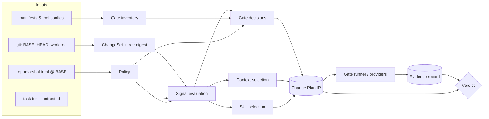

# Architecture

_Phase 3 (MISSION.md §64). Scope and vocabulary come from [`product-definition.md`](product-definition.md).
The decisions are recorded in [`adr/`](adr/). This document describes v0.1; anything marked (later) is
on the roadmap, not in v0.1._

## 1. Shape

RepoMarshal is a **compiler with a test runner attached**:

- **Front end:** parses git state and repository metadata into a *change set* and a *gate inventory*.
- **Middle:** evaluates a deterministic *signal catalogue* and *decision rules*, producing a
  versioned **Change Plan IR**.
- **Back end:** executes the plan's REQUIRED gates and folds their results into a verdict.



Python modules (stdlib only; see ADR-001): `git.py` (BASE, changed files, line diffs, tree
digest), `inventory.py`, `signals.py` (catalogue as data), `planner.py` (decisions, context,
skills), `policy.py` (TOML from BASE), `runner.py` (argv execution, timeouts, redaction),
`evidence.py`, `verdict.py`, `model.py` (IR dataclasses), `render.py` and `cli.py`.

`plan` never executes repository code. It only reads files and runs `git`, so it is safe on
untrusted repositories. `done` executes the repository's own commands, so it carries the same
trust as running `npm test` yourself.

## 2. Core entities (IR `schema_version: "0.1"`)

| Entity | Key fields |
|---|---|
| `ChangeSet` | `base` (sha), `head` (sha or null), `tree_digest`, `files[]`: `{path, status A/M/D/R, old_path?, added[], removed[]}` (lines, capped), `uncommitted: bool` |
| `Gate` (inventory) | `id` (e.g. `backend:unit`), `kind`, `argv[]`, `cwd`, `scope` (path prefix), `cost` cheap/standard/expensive, `source` (e.g. `backend/pyproject.toml#tool.pytest`), `provider` (`command` in v0.1; later `skillspector`, `playwright`, …) |
| `Signal` | `id` (e.g. `security.auth_path`), `domain`, `risk` low/standard/elevated, `files[]`, `detail` |
| `GateDecision` | `gate_id` or `kind`, `status` REQUIRED/SKIPPED/NOT_APPLICABLE/UNAVAILABLE, `reasons[]` (each `{signal?, text}`) |
| `ContextItem` | `path`, `why`, `priority`, `est_tokens` (bytes ÷ 4, labelled estimate) |
| `SkillPick` | `name`, `path`, `matched_domains[]`, `trust` (`repo@base` or `changed-in-diff`) |
| `Plan` | `schema_version`, `plan_hash`, `mode` (`forecast` without a diff, `binding` with one), `change`, `signals`, `domains`, `risk`, `context`, `skills`, `gates`, `evidence_level`, `policy {source, digest}`, `generator {name, version}` |
| `GateResult` | `gate_id`, `status` PASS/FAIL/UNKNOWN/WAIVED, `exit_code`, `duration_ms`, `stdout_sha256`, `stderr_sha256`, `output_tail` (redacted), `reason` |
| `EvidenceRecord` | `schema_version`, `plan_hash`, `base`, `head`, `tree_digest_before`, `tree_digest_after`, `policy_digest`, `results[]`, `verdict`, `verdict_reasons[]`, `prev_digest` (later), `record_digest` |

`plan_hash` is the sha256 of the canonical JSON of the plan with `plan_hash` itself removed. Canonical
JSON means sorted keys, no whitespace and UTF-8. The same rule produces `record_digest`.

## 3. Gate inventory on an unconfigured repository

### 3.1 Scopes

A **scope** is a directory that holds a recognised manifest: `package.json`, `pyproject.toml`,
`setup.cfg`, `Makefile`, `go.mod` (later), `Cargo.toml` (later). v0.1 looks at the repository root and
its immediate subdirectories.

Each gate belongs to the scope it was found in. A gate is relevant to a changed file when the file's
path starts with the gate's scope, and a root-scope gate is relevant to every file. This is the first
source of change-awareness: a frontend lint gate does not run for a backend-only diff.

### 3.2 Sources and their precedence

When several sources yield the same `(scope, kind)`, the one higher in this list wins. All sources are
read **at BASE**, so an agent cannot redefine a gate inside the change being judged (§7).

| # | Source | How gates are derived |
|---|---|---|
| 1 | `repomarshal.toml` `[gates.<id>]` | Explicit `kind`, `argv` (an array; strings are rejected), `scope`, `cost`, `timeout_s` |
| 2 | `AGENTS.md`, `## Commands` section | Bullets of the form `- Lint: \`cmd\`` (Build/Test/Lint/Typecheck/Format, case-insensitive). The command is split with `shlex.split`. Root scope |
| 3 | `package.json` `scripts` | `lint`→lint; `typecheck`, `type-check`, `tsc`→typecheck; `format:check`, `prettier:check`→format; `test`, `test:unit`→unit; `test:integration`→integration; `test:e2e`, `e2e`→runtime; `test:a11y`, `a11y`→a11y. argv is `[pm, "run", script]`, where pm comes from the lockfile (pnpm-lock→pnpm, yarn.lock→yarn, bun.lock*→bun, otherwise npm). The npm placeholder test (`echo "Error: no test specified"`) is ignored |
| 3 | `pyproject.toml`, `setup.cfg`, `pytest.ini`, `mypy.ini`, `ruff.toml` | `[tool.ruff]` or `ruff.toml`→lint `ruff check .`; `[tool.mypy]` or `mypy.ini`→typecheck `mypy .`; `[tool.pyright]`→typecheck `pyright`; pytest config or a `tests/` dir containing `test_*.py`→unit `python -m pytest -q`. If `tests/integration/` exists, unit gains `--ignore=tests/integration` and an integration gate runs that directory |
| 3 | `Makefile` | Targets matching `^(lint\|test\|typecheck\|check\|fmt-check\|format-check):` become `make <target>` (`check` maps to lint) |
| 4 | `.github/workflows/*.yml` (later) | Hints only. Single-line `run:` steps whose first token is a known tool (`pytest`, `ruff`, `mypy`, `eslint`, `tsc`, `npm test`) fill a `(scope, kind)` that no other source covers. Arbitrary CI commands are never executed |

**Availability.** A gate whose `argv[0]` does not resolve on `PATH`, for example ruff configured but
not installed, stays in the inventory with `available: false`. If the plan requires it, the decision
is **UNAVAILABLE** and the reason names the missing tool.

**Native gates.** v0.1 has two native gates. Both are deterministic and labelled as baseline checks:
- `docs:links`: relative links in changed Markdown files must resolve.
- `secrets:diff`: high-confidence secret patterns in *added* lines only, such as private-key headers,
  AWS access key IDs and GitHub tokens. It is not a replacement for gitleaks or trufflehog, which
  are planned providers.

### 3.3 Cost classes

Default cost by kind:
- **cheap:** docs, format, lint, secrets;
- **standard:** typecheck, unit, build;
- **expensive:** integration, runtime, a11y, dep_audit, security_scan, skill_audit.

**Cost never decides safety.** The §4 rules decide what is required. Cost only affects run order
(cheap first; `--fail-fast` is opt-in) and, later, *promotion*. Measured medians in
`.repomarshal/state/durations.json` can make a gate under 10 s run whenever its scope changed.
Measurements can only promote, never demote, so a forged durations file can only add work.

### 3.4 Worked example: the `webapp` fixture with no `repomarshal.toml`

```text
webapp/
├── AGENTS.md                    "## Commands" → - Test: `make test`
├── docs/install.md, docs/adr/0003-token-refresh.md
├── frontend/package.json        scripts: lint, typecheck, test, test:e2e, test:a11y; package-lock.json
├── frontend/src/components/LoginForm.tsx (+ .test.tsx), frontend/src/styles/login.css
├── backend/pyproject.toml       [tool.ruff] [tool.mypy] [tool.pytest.ini_options]
├── backend/app/auth/refresh.py, backend/app/api/routes.py
├── backend/tests/test_refresh.py, backend/tests/integration/test_auth_flow.py
└── .agents/skills/{ui-forms,auth-security,docs-writing}/SKILL.md
```

The inventory, at BASE:

| id | kind | argv | scope | cost | source |
|---|---|---|---|---|---|
| `root:unit` | unit | `make test` | `/` | standard | AGENTS.md#Commands (no Makefile at root, so `available: false`) |
| `frontend:lint` | lint | `npm run lint` | `frontend/` | cheap | frontend/package.json#scripts.lint |
| `frontend:typecheck` | typecheck | `npm run typecheck` | `frontend/` | standard | …#scripts.typecheck |
| `frontend:unit` | unit | `npm run test` | `frontend/` | standard | …#scripts.test |
| `frontend:runtime` | runtime | `npm run test:e2e` | `frontend/` | expensive | …#scripts.test:e2e |
| `frontend:a11y` | a11y | `npm run test:a11y` | `frontend/` | expensive | …#scripts.test:a11y |
| `backend:lint` | lint | `ruff check .` | `backend/` | cheap | backend/pyproject.toml#tool.ruff |
| `backend:typecheck` | typecheck | `mypy .` | `backend/` | standard | …#tool.mypy |
| `backend:unit` | unit | `python -m pytest -q --ignore=tests/integration` | `backend/` | standard | …#tool.pytest |
| `backend:integration` | integration | `python -m pytest -q tests/integration` | `backend/` | expensive | backend/tests/integration/ |
| `native:docs-links` | docs | (native) | `/` | cheap | built-in |
| `native:secrets-diff` | secrets | (native) | `/` | cheap | built-in |

No gate of kind `security_scan`, `dep_audit` or `skill_audit` exists. If a plan requires one, the
decision is UNAVAILABLE.

### 3.5 Root gates that cover workspace packages (v0.6)

Workspace packages (`package.json` `workspaces`, `pnpm-workspace.yaml`) are scopes of their own, so a
monorepo can have `root:unit` and `packages/zod:unit` while the root script already runs the
package's tests. Requiring both runs the same checks twice. The inventory therefore marks a
workspace package's script gate as **covered** by the root script gate of the same kind
(`Gate.covered_by = "root:<kind>"`, with a one-line `coverage_evidence`) when, and only when, there
is explicit evidence that the root script runs the package's check (`workspace.py`):

| Evidence | Root script (a `&&`-separated command of it) | Package gate |
|---|---|---|
| Recursive workspace runner | `pnpm -r [run] <s>`, `nub run -r <s>`, `npm run <s> --workspaces`, `yarn workspaces run <s>`, `yarn workspaces foreach -A run <s>`, `turbo run <s>`, `lerna run <s>` (and the package matches `lerna.json` `packages`, if listed) | any kind, script named `<s>` |
| Test runner projects (unit only) | `vitest [run]` whose root config (`--config`, else the first `vitest.config.*`, else `vite.config.*`; a `vitest.workspace.*` file when it has no `projects`) lists the package in `projects`; or `jest` whose root config (`jest.config.*` or `package.json` `jest`) lists it in `projects` | the script is the bare runner (`vitest run`, `jest`, optionally via `npx`/`pnpm exec`/`nub exec --node`), with no other argument and no pre/post hook |

Everything else is **no evidence**, and then both gates stay (the safe default). In particular:
filters and narrowing (`--filter`, `-F`, `--workspace`, `--scope`, `--since`, `--project`,
positional paths), unknown flags or extra arguments, a variable assignment in front of a command,
any shell operator other than `&&` (`;`, `||` and pipes can hide a failure), a projects array that
contains anything but string and object literals (a variable or spread could hide an exclusion),
several `projects` keys, a package script that adds options to the runner, and `nx run-many` (nx
targets can be redefined by `project.json` and plugins, so the package script is not necessarily
what runs). A root `biome lint .` does not cover a package's `tslint` script: a different tool is a
different check, whatever paths it walks.

The evidence is read at BASE, like every gate definition, and must **also hold in the working
tree**, with the package still a workspace package there. An agent that edits the root vitest
config, the root script or the `workspaces` list so that the root run no longer reaches the
package therefore keeps the package gate required (§7).

Decisions (§4.2) act on it per kind: when a covered package gate would be REQUIRED or UNAVAILABLE
and its covering root gate is itself REQUIRED or UNAVAILABLE, the package gate becomes SKIPPED with
the reason "covered by root:unit (required): <evidence>; its checks run once, at the root", and the
root decision lists the package gates it covers. A package gate whose own definition changed in
the change (M14) is never skipped this way, so its UNKNOWN still surfaces. Field effect: zod's
`packages/zod:unit` and `packages/mini:unit` are covered by `root:unit` through
`vitest.config.ts` `projects: ["packages/*", ...]`; `packages/tsc:lint` (tslint) is not.

## 4. Planning algorithm

### 4.1 Signal catalogue (v0.1)

Rules are data: an id, a matcher, a domain and a risk level. Matchers look at a file's path (by
segment, extension or glob), its status, and its added or removed lines.

| Signal id | Matches | Domain | Risk |
|---|---|---|---|
| `docs.changed` | Documentation file types only: `.md .markdown .rst .adoc`, README/LICENSE-style names, and docs formats or images under `docs/`. Other files under `docs/` go through the normal rules. `.mdx` is docs, code and `frontend.ui` | docs | low |
| `code.changed` | Source extensions (`.py .ts .tsx .js .jsx .go .rs .java .rb …`) | code | standard |
| `frontend.ui` | `.tsx .jsx .vue .svelte .css .scss .html`, or a `components/` path segment | frontend | standard |
| `tests.changed` | Test files (`test_*.py`, `*_test.py`, `*.test.*`, `*.spec.*`, `tests/`, `__tests__/`) | tests | standard |
| `security.auth_path` | A directory segment or file stem in {auth, oauth, login, session, sessions, token, tokens, security, crypto, permissions, acl}. Docs, stylesheets and images are exempt (`login.css` is not auth logic) | security | **elevated** |
| `security.sensitive_identifier` | Added code lines (not tests) matching `password\|secret\|token\|jwt\|bearer\|private_key\|hmac` | security | standard |
| `dependency.changed` | Lockfiles, `requirements*.txt`, or dependency sections of package.json / pyproject that differ between BASE and the worktree | dependencies | standard |
| `build.config_changed` | Non-dependency edits to manifests, `tsconfig*`, `*.config.{js,ts,mjs}`, `Makefile`, `setup.cfg`, `tox.ini` | build | standard |
| `ci.changed` | `.github/workflows/**`, `.gitlab-ci.yml`, `.circleci/**` | ci | **elevated** |
| `agent.config_changed` | `AGENTS.md`, `CLAUDE.md`, `.claude/**`, `.cursor/**`, `.mcp.json`, `.github/copilot-instructions.md` | agent-config | **elevated** |
| `agent.skill_changed` | `**/SKILL.md` and siblings under a skill directory | agent-config | **elevated** |
| `policy.self_modified` | `repomarshal.toml` | policy | **elevated** |
| `tests.deleted` | A deleted test file, or removed test definitions (`def test_`, `class Test`, `it(`, `test(`, `describe(`), not counting tests moved to another changed test file | tests | **elevated**; taints test gates (v0.2) |
| `tests.skip_added` | Skip, xfail or focus markers added in test files (`@pytest.mark.skip`, `pytest.skip(`, `it.skip`, `xit`, `it.only`, `fdescribe`, ...) | tests | **elevated**; taints test gates (v0.2) |
| `tests.discovery_narrowed` | Narrowed pytest/jest/vitest discovery (`testpaths`, `addopts -k`, `testPathIgnorePatterns`, ...) or narrowing flags added to scripts | tests | **elevated**; taints test gates (v0.2) |
| `db.migration` | A `migrations/` or `alembic/versions/` path segment | data | **elevated** |
| `coverage.unclassified` | A file that matched no rule above | unknown | standard |

The catalogue is versioned with RepoMarshal, and every signal id is stable. A policy may *add*
rules in `[[signals]]`. It cannot delete built-in ones (§7).

### 4.2 Decision procedure (deterministic pseudo-code)

```text
compile(change, inventory, policy, task):
  S = []
  for f in change.files:
     hits = [r for r in CATALOGUE + policy.rules if r.matches(f)]
     S += hits or [Signal("coverage.unclassified", f)]
  if not change.files: S = task_signals(task)   # forecast only; binding plans use the diff alone
  risk    = max(s.risk for s in S, default=low)
  widen   = any(s.id in WIDENING for s in S)     # build.config_changed, ci.changed, coverage.unclassified,
                                                 #   agent.config_changed, policy.self_modified, tests.*
  # v0.2: a test-tamper signal TAINTS the test-running gates (unit, integration, runtime, a11y) in
  # the scopes of its files. Tainted gates still run, but `done` reports their result as UNKNOWN.
  code_scopes = {scope(g) for g in inventory if any code/test file under scope(g)}
  if widen: code_scopes = all scopes

  for kind in KINDS:                             # fixed order: docs, format, lint, typecheck, unit,
     need, why = RULES[kind](S, risk, code_scopes)   #   integration, secrets, dep_audit, security_scan,
     gates = [g for g in inventory if g.kind == kind]  #   skill_audit, runtime, a11y
     if not need:
        for g in gates: decide(g, SKIPPED, why)            # why = "no <trigger> signal" or "no files in <scope>"
        if not gates:  decide(kind, NOT_APPLICABLE, "none configured; not needed")
        continue
     relevant = [g for g in gates if scope(g) in code_scopes or g.scope == "/"] if kind in SCOPED else gates
     for g in gates - relevant: decide(g, SKIPPED, f"no changed files under {g.scope}")
     usable = [g for g in relevant if g.available]
     for g in usable:               decide(g, REQUIRED, why)
     for g in relevant - usable:    decide(g, UNAVAILABLE, why + f"; {g.argv[0]} not found")
     if not relevant:
        if kind in WHEN_CONFIGURED: decide(kind, NOT_APPLICABLE, why + "; no tool configured")
        else:                       decide(kind, UNAVAILABLE, why + "; no gate or provider configured")
  evidence_level = elevated if risk == elevated else standard
  return Plan(..., plan_hash = sha256(canonical(plan)))
```

`RULES` (v0.1). A kind is needed when its trigger fires.

| Kind | Needed when | Absent → |
|---|---|---|
| docs | `docs.changed` | NOT_APPLICABLE |
| format, lint | `code.changed` or `tests.changed` in the gate's scope | NOT_APPLICABLE |
| typecheck | `code.changed` or `tests.changed` in the gate's scope | NOT_APPLICABLE |
| unit | `code.changed` or `tests.changed` in the gate's scope | **UNAVAILABLE** |
| integration | `db.migration`, `security.auth_path`, a test-tamper signal, or risk elevated together with `code.changed` (v0.3); `dependency.changed` alone no longer (v0.6) | **UNAVAILABLE** |
| secrets | Any `security.*`, `dependency.changed`, `agent.config_changed`, or risk elevated. v0.6: `dependency.changed` does not count when every file that raised it is a lockfile (`package-lock.json`, `pnpm-lock.yaml`, `yarn.lock`, `bun.lock(b)`, `uv.lock`, `poetry.lock`, `Pipfile.lock`, `pdm.lock`, `Cargo.lock`, `go.sum`, `composer.lock`, `Gemfile.lock`, `npm-shrinkwrap.json`) whose added lines are fully visible (not binary or truncated) and carry no credential-bearing URL; a manifest such as `package.json`, `pyproject.toml` or `requirements*.txt` still counts | (native, always present) |
| dep_audit | `dependency.changed` | **UNAVAILABLE** |
| security_scan | `security.auth_path` | **UNAVAILABLE** |
| skill_audit | `agent.skill_changed` | **UNAVAILABLE** |
| runtime | `frontend.ui`, or `security.auth_path` together with `code.changed` | **UNAVAILABLE** |
| a11y | `frontend.ui` | **UNAVAILABLE** |

Workspace coverage (§3.5) is applied after these rules, per kind. `dep_audit` and the widened
`unit` gates stay required for every dependency change.

`WHEN_CONFIGURED` holds the kinds marked NOT_APPLICABLE above. A repository without a linter has no
lint obligation. A required verification the repository cannot perform is UNAVAILABLE, and the
verdict reports it as UNKNOWN (§6).

### 4.3 Walkthrough: Scenario C, "Modify refresh-token handling"

The diff, uncommitted: `backend/app/auth/refresh.py` is modified, and the added lines contain
`refresh_token` and `jwt.decode`.

1. **Signals.** `code.changed` (refresh.py), `security.auth_path` (segment `auth`), and
   `security.sensitive_identifier` (added `token`, `jwt`). The task text "refresh-token" adds
   `task.security` (forecast only; it duplicates the diff signal).
2. **Risk and scopes.** Risk is **elevated** because of `security.auth_path`. There is no widening
   signal. `code_scopes = {backend/}`.
3. **Decisions:**

| Gate | Status | Reason |
|---|---|---|
| native:docs-links | SKIPPED | no `docs.changed` signal |
| frontend:lint, frontend:typecheck, frontend:unit | SKIPPED | no changed files under `frontend/` |
| backend:lint | REQUIRED | `code.changed` in `backend/` |
| backend:typecheck | REQUIRED | `code.changed` in `backend/` |
| backend:unit | REQUIRED | `code.changed` in `backend/` |
| root:unit (`make test`) | UNAVAILABLE | needed (root scope), but no Makefile, so `make test` cannot run |
| backend:integration | REQUIRED | `security.auth_path` (risk elevated) |
| native:secrets-diff | REQUIRED | `security.auth_path`, `security.sensitive_identifier` |
| dep_audit | NOT_APPLICABLE | no `dependency.changed` signal; none configured |
| security_scan | UNAVAILABLE | `security.auth_path`; no gate or provider configured |
| skill_audit | NOT_APPLICABLE | no `agent.skill_changed` signal; none configured |
| runtime (frontend:runtime) | SKIPPED for frontend; **kind UNAVAILABLE** | `security.auth_path` and `code.changed` need a runtime check *in backend/*, and none is configured there |
| a11y (frontend:a11y) | SKIPPED | no `frontend.ui` signal |

4. **Context** (§4.4): `refresh.py`, `backend/tests/test_refresh.py`, `docs/adr/0003-token-refresh.md`,
   `backend/app/auth/__init__.py`, `AGENTS.md`.
   **Skills** (§4.5): `auth-security`.
   **Evidence level:** elevated.
5. **`done` outcome** (zero-config). Even if every REQUIRED gate passes, the verdict is **UNKNOWN**,
   because security_scan and backend runtime are UNAVAILABLE and the root `make test` cannot run.
   That is the honest answer. Adding `[gates.security]` (for example bandit) and `[gates.runtime]` (a
   smoke script) to `repomarshal.toml` on main turns those gates into REQUIRED commands, and the
   verdict can then be PASS.

For contrast, Scenario A (`docs/install.md`) requires only `native:docs-links`. Scenario B
(`LoginForm.tsx`, `login.css`) requires frontend lint, typecheck, unit, runtime and a11y, and skips
every backend gate.

### 4.4 Context selection (deterministic heuristic, labelled as such)

Items are added in priority order, and each item records why it was chosen:

| Priority | What | Budget rule |
|---|---|---|
| P1 | Changed files | Always included |
| P2 | Tests paired by stem with changed files (`x.py` → `test_x.py`, `x.tsx` → `x.test.tsx` / `x.spec.tsx`) | Always included: tests are a correctness floor, not an optimisation target |
| P3 | Docs and ADRs whose filename tokens match a changed file's stem or path segments, or the domain's keywords (`token-refresh` ↔ `refresh.py`, `auth`) | Budget permitting |
| P4 | Other files in the changed files' directories; `AGENTS.md` | Budget permitting |

- **Budget:** `context.token_budget` (default 12,000). Token counts are `bytes / 4` and are labelled
  `estimate`. Items beyond the budget are listed as `excluded`, with their size and the reason.
- **Without a diff** (forecast mode), the candidates are paths whose segments match task keywords.

### 4.5 Skill selection

- **Inventory:** `SKILL.md` files under `.agents/skills/`, `.claude/skills/` and `skills/`, read at BASE.
- **Frontmatter:** a minimal parser for single-line `key: value` pairs; only `name` and
  `description` are used.
- **Scoring:** the number of distinct plan domains whose keyword set appears in the name or
  description. The highest score per domain wins.
- **Limits:**
  - at most `skills.max` picks (default 3);
  - a score of 0 is never picked;
  - ties are broken by name, so the result is deterministic.
- **Trust:** a skill that is new or modified in the diff is never recommended as trusted. It raises
  `agent.skill_changed`, and its audit is the `skill_audit` gate.

## 5. Evidence binding

### 5.1 Tree digest, including uncommitted work

Agents usually claim "done" before committing, so evidence binds to a **digest of the working tree**,
not just to HEAD:

```text
tmp = mkstemp() in the system temp dir            # never touches .git/index
GIT_INDEX_FILE=tmp git read-tree HEAD             # or `git read-tree --empty` on an unborn branch
GIT_INDEX_FILE=tmp git add -A -- . ':(exclude).repomarshal'
                                                  # staged + unstaged + untracked-not-ignored, deletions
tree_digest = GIT_INDEX_FILE=tmp git write-tree   # a git tree id over the exact content and modes
remove tmp
```

This covers the content, exec bits and symlink targets of every non-ignored file.

**Only BASE's `.gitignore` files are trusted** (fail-open review #6). An untracked file that the
agent-controllable rules ignore (`.git/info/exclude`, `core.excludesFile`, or a `.gitignore` edited
in the change) but BASE's rules don't is force-added. It becomes part of the digest and the change
set.
- **Cap:** above 500 such files, they go into `ChangeSet.opaque` instead, which forces UNKNOWN.
- **Embedded git repositories:** these are opaque too.
- **Tool caches:** directories that ignore themselves are skipped (`.ruff_cache`, `.pytest_cache`,
  `.mypy_cache`, `.pytype`, `__pycache__`, `.hypothesis`). `node_modules` is not skipped.
- **Line diffs:** these use `--text --no-textconv --no-ext-diff`, so git attributes cannot hide added
  lines. Binary status is decided by content.
`.repomarshal/` is excluded, so writing evidence never invalidates itself. The blobs it writes are
harmless loose objects that `git gc` removes, and the user's index and refs are untouched.
Limitations: ignored files (build outputs, `.env`) are not covered, and a dirty submodule is covered
only as its recorded gitlink.

### 5.2 What a verdict is bound to

- **Record contents:** every evidence record stores `base`, `head`, `tree_digest_before`,
  `tree_digest_after`, `plan_hash` and `policy_digest`.
- **`done` sequence:**
  1. Compute `tree_digest_before`.
  2. Compile the binding plan.
  3. Run the gates.
  4. Compute `tree_digest_after`.
- **Tree changed during the run:** the digest is also recomputed **after every gate** (fail-open
  review #3). A gate that modifies the tree, for example by swapping a file for later gates, gets an
  UNKNOWN result. If the digests differ at any point (a formatter rewrote files, or the agent kept
  editing), the verdict is **UNKNOWN**, with reason "working tree changed during verification".
- **Validity later:** a verdict is valid only while the current tree digest equals `tree_digest_after`.
  `repomarshal status` (later) recomputes it and reports a mismatch as **STALE**, which counts as no
  evidence. Any edit, commit of different content, or new untracked file invalidates the verdict.
  Committing exactly the verified content does not, because the tree id is unchanged.

## 6. Verdict semantics

- **Gate results:** a REQUIRED gate yields
  - PASS: exit code 0;
  - FAIL: non-zero exit;
  - UNKNOWN: timeout, the command could not start, or a provider reported incomplete analysis.
- **Folding:** an UNAVAILABLE decision folds in as UNKNOWN. SKIPPED and NOT_APPLICABLE are not
  results and never count as evidence.
- **Overall verdict precedence** (also exit codes, see product definition): BLOCKED (3) > FAIL (1) >
  UNKNOWN (2) > PASS (0).
  - **BLOCKED:** the policy at BASE is invalid, or a waiver violates policy.
  - **No REQUIRED gates at all** (for example, an empty diff): **UNKNOWN**, "nothing was verified".
    Having nothing to prove is not a pass.
- **WAIVED (later):** a recorded human decision. A WAIVED gate counts as PASS only if
  `completion.waivers_permit_pass = true` at BASE. It is always listed in the verdict.

## 7. Tamper resistance and trust boundary

The coding agent runs as the same OS user and can write any file, including `.repomarshal/`. A local
tool **cannot** stop a determined same-user adversary from forging local files. The design therefore
makes sure local files are never the source of truth for a verdict:

1. **Re-execution, not trust.** `done` computes its verdict only from gates it executes in that
   invocation. v0.1 has **no result cache**. Evidence files are *outputs* (an audit trail for
   humans and CI), never inputs to a verdict. Editing or forging `.repomarshal/evidence/*.json`
   changes nothing that `done` decides.
2. **Policy and gate definitions come from BASE**, via `git show <base>:<path>`, never from the
   working tree or from `.repomarshal/`. An agent that edits `repomarshal.toml`, `package.json`
   scripts, `pyproject` tool sections, `AGENTS.md` Commands or CI cannot weaken the current
   evaluation. Those edits raise `policy.self_modified`, `build.config_changed`,
   `agent.config_changed` or `ci.changed`, which elevate risk and widen the plan.
   - **Residual gap:** `npm run test` resolves the script body from the *working-tree* package.json
     at run time. v0.1 detects the edit (`build.config_changed`). The planned
     `gates.definition_changed` rule makes such a gate's result UNKNOWN (threat model T3).
3. **BASE resolution is recorded, not trusted.** The default order is:
   1. `--base`;
   2. merge-base with `origin/HEAD`;
   3. `origin/main` or `origin/master`;
   4. `main` or `master`.

   An agent that commits directly to the base branch can shift BASE, so every evidence record states
   the BASE it used. The first BASE seen per branch is also remembered in
   `$GIT_DIR/repomarshal/base.json` (v0.3: never in the working tree, so a commit cannot plant it). Later automatic resolutions take the merge-base of the
   remembered and the automatic BASE, so moving a ref can only widen the diff (fail-open review #2).
   Deleting the state only restores plain automatic resolution. An explicit `--base` (CLI or MCP)
   may be agent-supplied, so it can only *widen* the diff (merge-base with that floor) and is
   never remembered. A Claude Code `SessionStart` hook anchors BASE before the agent works (v0.2).
4. **The authoritative anchor is a party the agent does not control.** CI, or a reviewer's machine,
   re-runs `repomarshal done` from scratch on the pushed commit and compares verdicts. A local PASS
   is advisory for the inner loop. This is written in the README and in every `done` output footer.
5. **Digests catch accidents, not attackers.** `record_digest`, and the hash chain via
   `prev_digest` (later), detect accidental or casual edits to the audit trail. They are not a
   security boundary against the same user. v0.1 does no signing; key management is out of scope.
6. **Output hygiene.**
   - Only the last 40 lines of each stream are kept, after redaction (tokens, keys, `Authorization`
     headers, connection-string passwords). Full streams are hashed, not stored.
   - Gate commands run with argv lists. `shell=True` is never used.
   - Config argv must be arrays.

## 8. Persistence

```text
repomarshal.toml                 committed policy (optional); read from BASE only
.repomarshal/                    local outputs; excluded from the tree digest; never read for verdicts
├── plans/<plan_hash>.json
├── evidence/<utc-timestamp>-<plan_hash[:12]>.json
└── state/durations.json         (later) promotion data only
```

`init` (a v0.1 SHOULD) writes a commented `repomarshal.toml` and suggests a `.gitignore` line. It
does not edit agent configuration.

## 9. Failure semantics

| Situation | Behaviour |
|---|---|
| Not a git repository, or git missing | Exit 3 (BLOCKED), with a structured error |
| BASE unresolvable | Use the empty tree as BASE. The plan is marked `base: none`. Every file counts as added |
| Invalid `repomarshal.toml` at BASE | BLOCKED. The errors list key paths. Never silently fall back to defaults |
| Gate times out (`timeout_s`, default 600) | That gate is UNKNOWN. The process group is killed |
| Command not found at run time | UNKNOWN, with the reason |
| Unreadable or binary changed file | Path signals only. No content signals; recorded in the plan |
| Internal error | Exit 4. Never an exit code that could be mistaken for PASS |

## 10. Privacy and security boundary

RepoMarshal opens no sockets and sends no telemetry. Gate commands may use the network, because that
is the repository's own behaviour, and `--dry-run` lists them first. Providers that egress by
default (SkillSpector's OSV lookups, Reticle telemetry) are run with their opt-outs. RepoMarshal is
not a sandbox and enforces no tool permissions.

## 11. Agent interoperability and caching

Agent interoperability (MCP stdio tools with an explicit `repo_path`, and host stop-hook shims) is
decided in [ADR-003](adr/003-agent-interoperability.md).

Result caching is deferred: v0.1 always re-executes (§7). The planned cache key and its limits are
in [ADR-004](adr/004-evidence-model.md).
